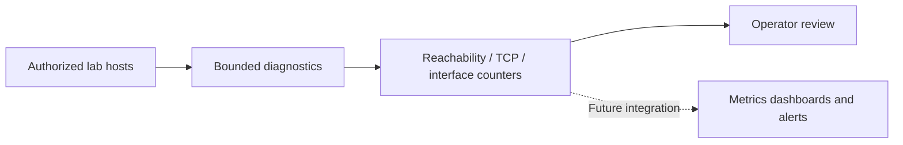

# Network Monitoring Toolkit

Small, bounded network diagnostic tools for **owned or explicitly authorized** systems. This repository currently contains working *implementations* of basic reachability checks, TCP connect checks, and Linux interface byte-counter sampling, plus offline unit tests. End-to-end lab validation is still pending.

## Implemented

| Tool | Purpose | Platform |
| --- | --- | --- |
| `scripts/ping_sweep.sh` | Ping up to 16 specified numeric addresses (not a subnet sweep) | Linux/macOS |
| `scripts/port_scanner.py` | TCP connect checks against one numeric IP, up to 20 ports | Python 3 |
| `scripts/bandwidth_monitor.sh` | Sample Linux interface RX/TX byte counters for one second | Linux |
| `scripts/live_demo.sh` | Interactive menu using loopback targets | Linux (macOS menu options 1–2) |
| `tests/test_port_scanner.py` | Offline Python unit tests using mocked sockets | Python 3 |
| `.github/workflows/tests.yml` | CI unit tests and Bash syntax checks | GitHub Actions |

## Architecture (reference only)



The dashboard integration is **not implemented**. See [architecture and validation](docs/architecture-and-validation.md) and [quick start](docs/quickstart.md).

## Quick start

```bash
git clone https://github.com/Ainny1/Network-monitoring-toolkit.git
cd Network-monitoring-toolkit
python3 -m unittest discover -s tests -v
python3 scripts/port_scanner.py 127.0.0.1 --ports 22,80,443
bash scripts/ping_sweep.sh 127.0.0.1
bash scripts/live_demo.sh
```

For Linux interface counters: `bash scripts/bandwidth_monitor.sh lo`.

**Use only loopback or systems you are authorized to assess.** No public IP address is needed. Ping and TCP failures can have many causes; neither is proof of compromise.

## Validation status

- [x] Source code and offline unit tests added
- [ ] CI run observed passing on GitHub
- [ ] Commands executed in a documented local lab
- [ ] Real monitoring dashboard configured and validated
- [ ] Redacted evidence and screenshots captured

## Planned integrations

Prometheus, Grafana, Zabbix, Nagios, alert rules, and dashboards are **ideas for future work**, not currently deployed features. Screenshots are not included until real lab captures are available.

## Contributing and license

See [CONTRIBUTING.md](CONTRIBUTING.md). MIT licensed; see [LICENSE](LICENSE).
