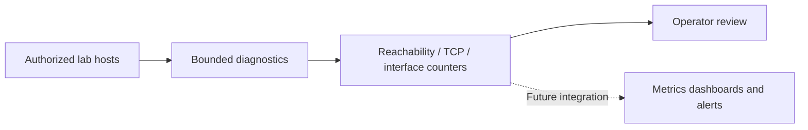

# Network Monitoring Toolkit

[](https://github.com/Ainny1/Network-monitoring-toolkit/actions/workflows/tests.yml)


Small, bounded network diagnostic tools for **owned or explicitly authorized** systems. This repository currently contains working *implementations* of basic reachability checks, TCP connect checks, and Linux interface byte-counter sampling, plus offline unit tests. A local Docker Compose Prometheus + Grafana lab is now configured, but **runtime validation and real screenshots are still pending**.

## Implemented

| Tool | Purpose | Platform |
| --- | --- | --- |
| `scripts/ping_sweep.sh` | Ping up to 16 specified numeric addresses (not a subnet sweep) | Linux/macOS |
| `scripts/port_scanner.py` | TCP connect checks against one numeric IP, up to 20 ports | Python 3 |
| `scripts/bandwidth_monitor.sh` | Sample Linux interface RX/TX byte counters for one second | Linux |
| `scripts/live_demo.sh` | Interactive menu using loopback targets | Linux (macOS menu options 1–2) |
| `tests/test_port_scanner.py` | Offline Python unit tests using mocked sockets | Python 3 |
| `.github/workflows/tests.yml` | CI unit tests and Bash syntax checks | GitHub Actions |

## Architecture (reference only)



The dashboard integration is **not implemented**. See [architecture and validation](docs/architecture-and-validation.md) and [quick start](docs/quickstart.md).

## Documentation

- [Quick start and commands](docs/quickstart.md)
- [Troubleshooting local diagnostics](docs/troubleshooting.md)
- [Architecture and validation status](docs/architecture-and-validation.md)
- [Local Prometheus/Grafana lab setup](docs/monitoring-lab.md)

The CI badge reports the GitHub Actions workflow state; it does **not** verify that the optional monitoring dashboard is deployed or working.

## Quick start

```bash
git clone https://github.com/Ainny1/Network-monitoring-toolkit.git
cd Network-monitoring-toolkit
python3 -m unittest discover -s tests -v
python3 scripts/port_scanner.py 127.0.0.1 --ports 22,80,443
bash scripts/ping_sweep.sh 127.0.0.1
bash scripts/live_demo.sh
```

For Linux interface counters: `bash scripts/bandwidth_monitor.sh lo`.

**Use only loopback or systems you are authorized to assess.** No public IP address is needed. Ping and TCP failures can have many causes; neither is proof of compromise.

## Validation status

- [x] Source code and offline unit tests added
- [ ] CI run observed passing on GitHub
- [ ] Commands executed in a documented local lab
- [ ] Real monitoring dashboard configured and validated
- [ ] Redacted evidence and screenshots captured

## Optional local monitoring dashboard

The repository includes a **Prometheus + Grafana** Docker Compose lab, with a provisioned Prometheus self-monitoring dashboard. It is not a claim that monitoring services are currently running.

1. Install Docker Desktop (Linux containers).
2. Copy `.env.example` to `.env` and replace the placeholder Grafana admin password.
3. Run `docker compose config` then `docker compose up -d`.
4. Open `http://127.0.0.1:3000` and view **Network Toolkit | Prometheus Health**.
5. Follow the [full monitoring lab guide](docs/monitoring-lab.md) to validate the services and capture genuine screenshots.

No dashboard screenshots are included until the lab is actually run.

## AWS deployment preparation

An optional [AWS private EC2 template and deployment checklist](aws/README.md) is included. **No cloud resources have been created, and no charges have been authorized.** The template has no inbound security-group rules and is designed for access through AWS Systems Manager. It requires explicit cost review and manual setup before it can run.

## Planned integrations

Prometheus and Grafana configuration files are included for a local lab, **not yet runtime-verified**. Zabbix, Nagios, host/network exporters, and alert rules remain future work. Screenshots are not included until real lab captures are available.

## Contributing and license

See [CONTRIBUTING.md](CONTRIBUTING.md). MIT licensed; see [LICENSE](LICENSE).
