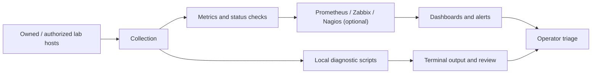

# Network Monitoring Toolkit — Architecture and Safe Validation

This page describes a **reference architecture**, not a verified deployment. The repository README mentions Prometheus, Grafana, Zabbix, Nagios and custom scripts; these components are options, not evidence that every integration is installed and functioning.

## Monitoring workflow

**Diagram key:** Boxes represent conceptual roles; arrows show intended data flow, not a measured or implemented integration.

## Safe operating boundaries

- Run ping sweeps and port checks **only** against your own lab hosts or networks with explicit permission.
- Set a narrow scope, reasonable rate, and timeout; avoid broad Internet scanning.
- Do not run scripts with administrator privileges unless a specific step requires them.
- Avoid publishing real infrastructure IP addresses, authentication details, SNMP community strings, or credentials.
- Verify script behavior before executing it; do not assume the README examples are production-safe.

## Evidence-driven lab walkthrough

1. **Inventory**: Record the lab subnet, number of devices, OS, and permission boundary; anonymize before publishing.
2. **Baseline**: Record expected host availability and normal network utilization.
3. **Collect**: Execute a documented, narrowly scoped check against an owned test host.
4. **Compare**: Note expected versus observed output and the timestamp.
5. **Visualize**: If a monitoring server is configured, include a redacted dashboard screenshot with the query or metric source.
6. **Respond**: Explain what an operator would investigate if the check failed.
7. **Clean up**: Stop background monitoring jobs and remove temporary resources.

## Evidence checklist

| Evidence | Status |
| --- | --- |
| Network diagram with anonymized host roles | Reference diagram above |
| Commands and environment versions | To capture during lab |
| Expected result and actual result | Not yet validated |
| Dashboard with real sample metrics | Not yet validated |
| Alert threshold and observed trigger | Not yet validated |
| False positives and monitoring limitations | To document |

## Important limitations

Host reachability does not establish system health. A closed or filtered port is not proof of compromise. Metrics and alerts can be delayed or absent due to permissions, firewall rules, agent configuration, and ingestion issues. Treat this toolkit as an educational lab until the specific scripts and integrations have been tested in a controlled environment.
